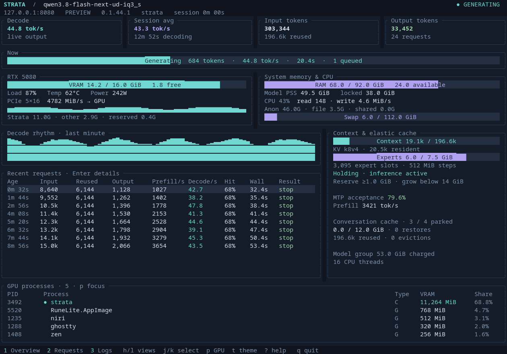
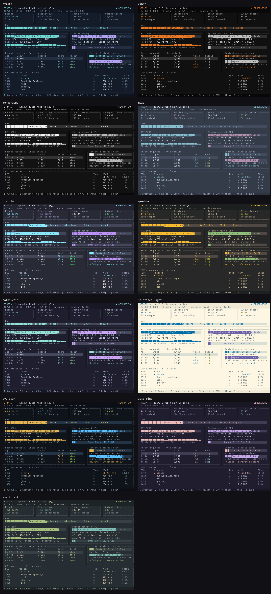

# strata-wrap

A Rust / Ratatui dashboard for Strata, with model supervision and automatic VRAM management.



Install from crates.io:

```sh
cargo install strata-wrap --locked
strata-wrap --preview
strata-wrap /path/to/model.json --strata-dir /path/to/Strata
```

Strata must already be installed with its server environment at `.venv` inside
its checkout. The default checkout is `~/apps/Strata`; use `--strata-dir` for
another location. Requirements: Linux, Rust 1.88+, a systemd user manager, and
one NVIDIA GPU with its driver installed. The wrapper itself is entirely Rust.

For the existing `iq3_s` and `ud-iq3_s` configs under `~/apps/Strata`:

```sh
strata-wrap iq3_s
strata-wrap ud-iq3_s
```

The optional `strata-wrap install` helper enables elastic mode in both of those
configs, links the executable under `~/.local/bin`, and updates existing Fish
abbreviations `sa` and `saud` in `~/.config/fish/.config.local.fish`. It expects
both configs and abbreviations to exist. It backs up changed files under
`~/.local/state/strata-wrap/backups`. Reload an existing shell with
`source ~/.config/fish/.config.local.fish`. For other setups, use a model JSON
path and enable elastic mode in that config.

## Dashboard

- Live prefill or decode speed in the first card, switching with the current phase, plus prompt progress, elapsed time, and queued requests. Prefill shows the engine-reported rate for the current prompt.
- Session input and output tokens, prompt reuse, and average output speed. The session average is **total output tokens / active decode seconds**. Idle time and prompt processing are excluded. In-flight output is included using Strata's reported mean decode rate.
- GPU utilization, temperature, power, VRAM, PCIe traffic, CPU use, disk throughput, RAM, and swap.
- Model memory from the service's processes: proportional resident memory (PSS), anonymous/file/shared pages, locked memory, and total memory charged to the service group. Locked memory is part of resident memory; service-group accounting also includes charged file cache. These measurements overlap and should not be added together.
- Context occupancy, KV configuration, expert-cache size, resize state, MTP acceptance, and conversation-cache occupancy, restores, and evictions.
- Request history with prefill/decode rates, cache reuse, expert hits, duration, and completion reason. Prefill rates use the actual tokens read when the engine reports them, with prompt minus reused tokens as the fallback for older engines. Select a request for its timing and token details.
- A scrolling log that retains its position when new output arrives.

GPU processes include both compute and graphics workloads, sorted by VRAM usage and deduplicated by PID. The panel occupies at most one quarter of terminal height and disappears when that space cannot fit a header and three entries. Press `p` to scroll through processes beyond the visible rows. Missing driver counters are reported as unavailable. GPU readings use NVML directly. The VRAM bar counts all non-free memory, including driver-reserved memory, so used plus free equals total before display rounding. The breakdown separates Strata, other allocations, and driver-reserved memory. The growth threshold uses that same used total. RAM used is total minus available, including reclaimable memory in the available figure. Values displayed in GiB are rounded independently to one decimal place.

## Keys

| Keys | Action |
| --- | --- |
| `h` / `l`, left / right | Previous / next view |
| `1` / `2` / `3`, Tab | Overview / requests / logs |
| `j` / `k`, down / up | Select requests or scroll logs / focused GPU processes |
| `gg` / `G`, Home / End | First / last request; oldest / newest logs |
| Ctrl+U / Ctrl+D | Half-page up / down |
| Ctrl+B / Ctrl+F, PageUp / PageDown | Page up / down |
| Enter | Open the selected request's details |
| `p` / Esc | Focus GPU processes / return |
| `t` | Open the theme picker; `hjkl` previews, Enter applies, Esc cancels |
| `b` | Open Strata's web dashboard |
| `?` / Esc | Open / close help |
| `q`, Ctrl+C | Stop Strata and exit; repeat to force |

The layout adapts to terminal size, with a compact summary below 50 columns or 14 rows. `NO_COLOR` is respected. Redirected output uses plain summaries automatically; `--plain` selects those explicitly and `--raw` includes unfiltered server output in plain mode.

```sh
strata-wrap --demo                      # Preview without starting a model
strata-wrap /path/to/model.json         # Another elastic Strata config
strata-wrap iq3_s --plain
strata-wrap iq3_s -- --idle-unload 120   # Forward Strata server options after --
```

The server stays on loopback, with the API key read from its model config. The existing web dashboard remains available on port 8080; `--port` changes both the listener and monitoring address. Logs rotate at 8 MiB with three backups under `~/.local/state/strata-wrap/`. Strata's native engine log remains at the path in its config.

## Themes

The original palette, `strata`, remains the default. Press `t` to preview themes
on the dashboard. Move with `hjkl`, arrow keys, or Tab. Enter saves the selection
for future launches; Esc restores the previous palette. This also works while
the model is generating.

| Theme | Appearance |
| --- | --- |
| `strata` | Midnight blue with sea glass and lavender |
| `ember` | Black and white with burnt orange accents and graphs |
| `monochrome` | Grayscale throughout, including status indicators and graphs |
| `nord` | Polar slate with frost blue and muted aurora colors |
| `dracula` | Charcoal violet with bright pastel accents |
| `gruvbox` | Warm charcoal with earthy gold and aqua |
| `catppuccin` | Mocha with soft teal and mauve |
| `solarized-light` | Warm ivory with blue and violet accents |



```sh
strata-wrap iq3_s --theme ember         # Override the saved theme for this launch
strata-wrap --list-themes
strata-wrap --preview --theme ember     # Run alongside an existing session
```

`--preview` (also available as `--demo`) uses sample data. It starts no server,
opens no listener, and makes no systemd, VRAM, or preference changes. Press `t`
to try palettes and `q` to close it. The running model continues independently.
You can also launch `./strata-wrap --preview` from a separately built worktree.

Normal sessions save confirmed selections to
`$XDG_CONFIG_HOME/strata-wrap/preferences.json`, or
`~/.config/strata-wrap/preferences.json` when that variable is unset.
`--theme` takes precedence without saving; selecting a theme in the picker saves
it. A running session keeps its own palette when another session changes the
saved choice. Snapshots default to `strata`; pass `--theme` to render another
palette.

The inspired palettes adapt [Nord](https://www.nordtheme.com/docs/colors-and-palettes/),
[Dracula](https://draculatheme.com/contribute),
[Gruvbox](https://github.com/morhetz/gruvbox),
[Catppuccin Mocha](https://github.com/catppuccin/catppuccin), and
[Solarized](https://ethanschoonover.com/solarized/) for this dashboard.

## VRAM policy

Every two seconds, the supervisor checks total GPU memory use. Below 1,024 MiB free, it requests another 512 MiB cache reduction. A confirmed reduction allows another shrink after the cooldown. A no-op suppresses that direction until available memory, cache size, or inference activity changes meaningfully.

Growth requires GPU usage below 14,336 MiB and no inference for 60 continuous seconds. Each growth step needs a fresh quiet period. New inference, a resize, missing telemetry, or crossing the usage threshold resets that timer. Growth preserves at least 1,024 MiB free and stops at the engine's initial full cache size.

Strata's endpoint takes a free-memory target rather than a cache delta. Targets include a 16 MiB accounting margin in both directions because NVML and CUDA can disagree slightly. Concurrent allocations and segment rounding can change the actual result. Only one resize may be outstanding; responses must confirm a cache-size change. A failed or uncertain resize pauses management until restart. The server keeps serving inference.

A shrink may wait behind an inference request, and only the expert cache can shrink. The reserve is best effort; this cannot guarantee room for a sudden allocation burst.

```sh
strata-wrap iq3_s --min-free-mib 1024 --grow-below-mib 14336 \
    --grow-delay 60 --poll 2
```

## Shutdown

Every launch owns a transient `strata-wrap.service` user service. It starts on demand, without a restart loop or boot activation. Duplicate launches are refused. A port lock also prevents separate wrapper units from managing the same server.

```sh
systemctl --user stop strata-wrap
```

Shutdown sends SIGTERM to Strata for its normal cleanup. An unresponsive server is killed after 12 seconds. systemd's `KillMode=mixed` and 20-second stop timeout contain and clean up all descendants, including children that create separate process groups or sessions. Killing the service's main wrapper also cleans up the engine. The worker watches the foreground launcher's pidfd, so killing that launcher triggers shutdown too. Terminal state is restored on normal exit, errors, handled signals, and panics.

## Development

```sh
cargo build --release --locked
./strata-wrap --preview
cargo test --locked
cargo clippy --all-targets --locked -- -D warnings
cargo fmt --check
cargo build --release --locked
```

Tests cover weighted session throughput, navigation, scrolling, resize timing, no-op handling, all palettes and overlays at small terminal sizes, grayscale output, theme selection and persistence, preview isolation, and the process-panel height limit. Integration tests use the real systemd user manager and a Rust HTTP fixture whose child escapes into a new session and ignores SIGTERM. They exercise interrupt, hangup, termination, launcher and worker SIGKILL, service stop, server crashes, duplicate launches, and installation. The ignored `fixture_process` test is the child fixture entry point, not a skipped check. Integration tests use port 18089 and remove their transient services afterward.

## Releases

CI checks formatting, Clippy, tests, crate packaging, and Rust 1.88 compatibility.
The Linux runner starts a systemd user manager for the lifecycle tests; it does
not need an NVIDIA GPU.

Version tags such as `v0.2.0` verify the matching Cargo version, publish to
crates.io through GitHub OIDC Trusted Publishing, and attach a Linux x86_64
binary to a GitHub release. The crates.io publisher is restricted to
`lindestad/strata-wrap`, `.github/workflows/release.yml`, and the `crates-io`
environment. The first crate version is published manually before configuring
Trusted Publishing. A release skips crate upload when that version is already
published, so the bootstrap release can still build its binary.

## License

MIT. See [LICENSE](LICENSE).
